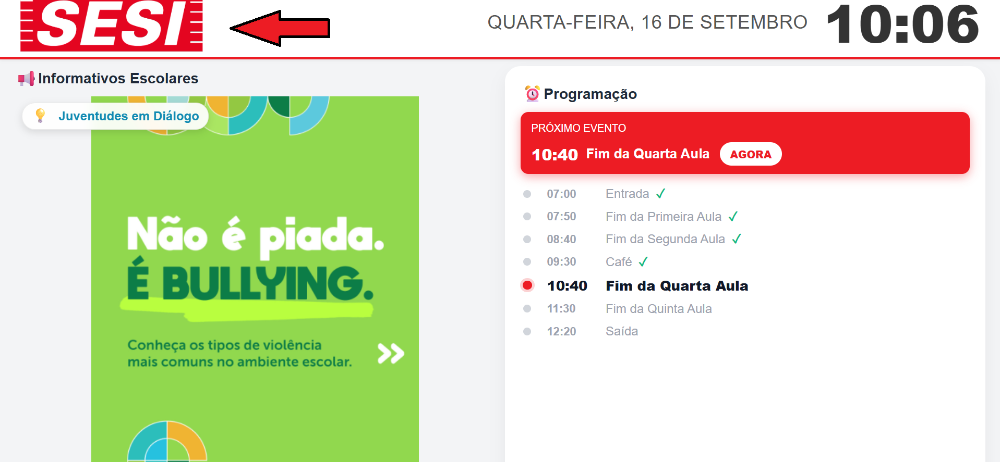
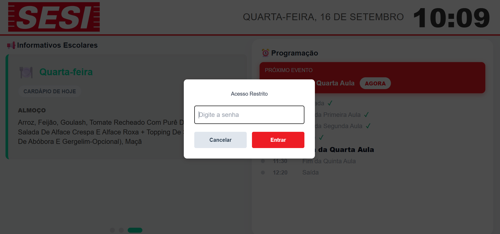
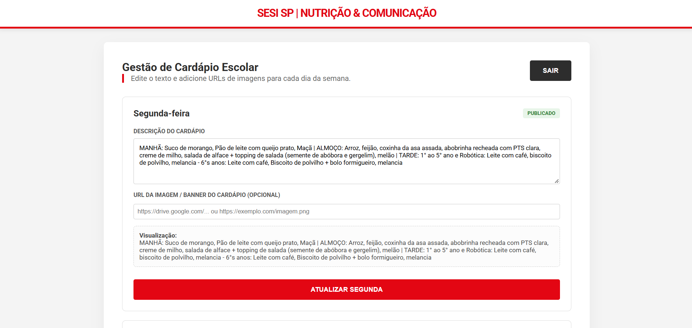
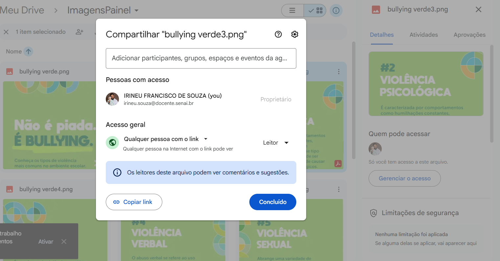
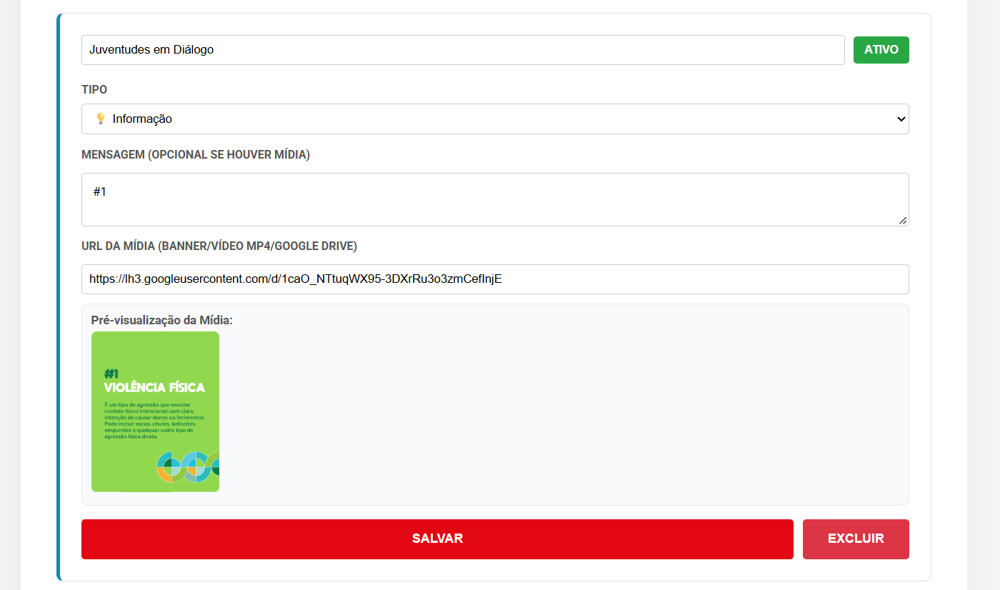
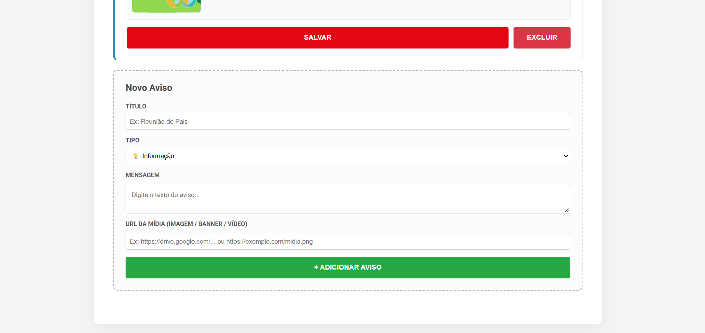

# 📘 Guia de Uso: Gerenciador de Cardápios e Avisos (SESI SP)

> **Documento Oficial de Instruções e Especificações do Painel**  
> *Link para acesso http://10.187.226.125:8102/*

---

## 1. 📌 Apresentação do Sistema

Este documento fornece as instruções atualizadas de como acessar e operar o **Gerenciador de Cardápios e Avisos do SESI SP**. O sistema é a solução oficial de comunicação visual e gestão de cardápios escolares para os monitores e TVs da unidade.

### 🌟 Especificações e Recursos Principais:
- **⏰ Sincronização Automática de Hora:** Relógio sincronizado diretamente com a hora do servidor Linux de hospedagem via HTTP, garantindo pontualidade exata nos alarmes de aulas e refeições.
- **⚡ Leitura Local Resiliente (`/avisos.json`):** Os avisos são consumidos via JSON local no próprio servidor, evitando falhas de sinal de internet ou erros de certificados SSL em Smart TVs.
- **🔔 Alertas Sonoros Inteligentes:** O painel emite alertas sonoros automáticos com *fade-in* progressivo de volume nos horários de entrada, café (refeição), trocas de aula e saída.
- **🎬 Mídias, Banners:** Suporte a imagens, banners informativos e links do **Google Drive**.

---

## 2. 🔐 Acesso ao Gerenciador

O ponto inicial para acessar o gerenciador é a própria tela principal do painel em exibição nas TVs ou nos computadores da unidade.

1. **Localize o Logo do SESI:** Na tela principal do painel (ex: `http://10.187.226.125:8102/`), clique sobre o **Logo do SESI** (no canto superior esquerdo).

2. **Janela de Acesso Restrito:** Uma caixa flutuante de segurança aparecerá solicitando a senha de administrador.

3. **Informe a Senha de Acesso:** Digite a senha oficial: `sesisenai@283` e clique no botão **Entrar** (ou pressione a tecla *Enter*).
4. **Redirecionamento Automático:** Uma nova aba será aberta automaticamente no seu navegador com o **Gerenciador de Cardápios e Avisos** (`cardapio.html`).

---

## 3. 🍽️ Gestão do Cardápio Escolar

Ao carregar o Gerenciador, o sistema carrega automaticamente os dados gravados. Serão exibidos os quadros correspondentes a cada dia útil da semana (Segunda a Sexta-feira).

### ⚠️ Regra de Formatação Obrigatória dos Textos:
Para que a refeição seja apresentada de forma organizada e legível para os alunos na TV, é **obrigatório** utilizar a barra vertical `|` como separador de períodos:

```text
MANHÃ: [itens] | ALMOÇO: [itens] | TARDE: [itens]
```

**Exemplo prático:**
```text
MANHÃ: Leite com Nesquik, Pão com manteiga | ALMOÇO: Arroz, feijão preto, frango à parmeggiana, salada | TARDE: Suco de uva, maçã
```

> **💡 Exibição Automática no Painel:** O painel exibe a refeição correspondente ao horário atual:
> - **Manhã:** Exibido até as 09:30
> - **Almoço:** Exibido das 09:30 às 12:30
> - **Tarde:** Exibido a partir das 12:30

### 🖼️ NOVO — Imagem / Banner do Cardápio (Opcional):
- É possível colar a **URL da Imagem / Banner do Cardápio** no campo indicado.
- Aceita links diretos de imagens e **links compartilhados do Google Drive(a imgens deve ter permissão de acesso geral para qualquer pessoa com o link)**. 

O sistema converte automaticamente links do Google Drive para exibição imediata no painel.


### 📝 Salvar Alterações:
1. Veja a prévia em tempo real no campo **Visualização**.
2. Clique no botão vermelho **ATUALIZAR [DIA]** (ex: *Atualizar Segunda*).
3. Uma notificação verde de sucesso confirmará o salvamento no banco de dados e no servidor local.

---

## 4. 📢 Gestão de Avisos Gerais, Banners

Na parte inferior do Gerenciador, a seção **Gestão de Avisos Gerais** permite cadastrar informativos, avisos de eventos e alertas de saúde.


### 🎨 Tipos de Avisos e Cores Temáticas:
| Ícone | Tipo | Cor Temática | Recomendado Para |
| :---: | :--- | :--- | :--- |
| ⚠️ | **Importante** | `#EF476F` (Vermelho) | URGENTE, Alertas, Mudanças de horário |
| 🎉 | **Evento** | `#FEC601` (Amarelo) | Festas, Feira de Ciências, Interclasses |
| 📚 | **Lembrete** | `#06D6A0` (Verde) | Devolução de livros, Tarefas, Provas |
| 💡 | **Informação** | `#118AB2` (Azul) | Comunicados gerais, Dicas |
| 🏥 | **Saúde** | `#FF6B35` (Laranja) | Vacinação, Atividades físicas, Prevenção |
| 🖼️ | **Banner / Imagem** | `#8E44AD` (Roxo) | Cartazes prontos, Artes em PDF/PNG |

| 🍽️ | **Cardápio** | `#10B981` (Verde Esmeralda) | Cardápios especiais |


### ➕ Como Criar um Novo Aviso:
1. Desça até o último quadro tracejado chamado **Novo Aviso**.
2. Informe o **Título** (ex: *Reunião de Pais*, *Interclasses*).
3. Selecione o **Tipo** no menu suspenso (aplica ícone e cor automática).
4. Digite a **Mensagem** (opcional se houver mídia informando).
5. Cole a **URL da Mídia** (opcional: link de imagem, banner).
6. Verifique a **Pré-visualização da Mídia** que aparecerá no quadro.
7. Clique no botão verde **+ ADICIONAR AVISO**.




---

## 5. 🛠️ Gerenciando Avisos Existentes

- **Ativar / Desativar Exibição (Status):**  
  Clique no botão de status no canto superior direito do card para alternar entre **Ativo** (fundo verde) e **Inativo** (fundo escuro). Avisos inativos ficam ocultos da TV sem precisarem ser excluídos.
- **Editar / Atualizar:**  
  Altere qualquer texto, título, tipo ou URL de mídia diretamente nos quadros dos avisos existentes e clique no botão **Salvar** correspondente.
- **Excluir:**  
  Clique no botão vermelho **EXCLUIR** para remover o aviso definitivamente do gerenciador e da exibição da TV.

---

*Documentação oficial atualizada do sistema NovoPainelSesi.*
